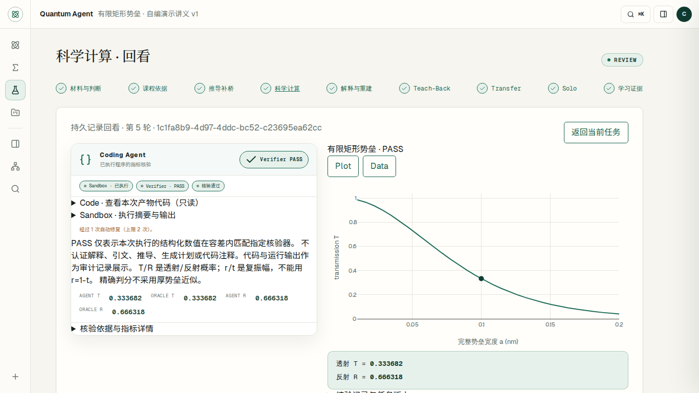

# QuantumAgent

QuantumAgent 是面向量子物理教学的工作流驱动智能体，将课程证据检索、科学工具、代码执行与结果核验接入教学过程，引导学习者先作答，再经历诊断、计算、回讲与独立迁移。项目基于现有模型与框架开发，工程重点是教学流程约束、证据追溯和可核验的运行记录。

作者 **谢翔宇**，独立开发、单人参赛。作品 **QuantumAgent——面向《量子物理》课程的Learning-Native多智能体教学系统** 获得中国科学技术大学 **“一〇七杯”算力与智能体开发大赛智能体赛道研究生组二等奖**。作品名称、获奖队员与奖项可在 [2026 年 9 月 20 日官方公示](https://www.teach.ustc.edu.cn/notice/notice-info/20582.html)中核实。

[观看原始演示](docs/implementation/evidence/video-parity-flash-20260918/main-raw.webm) · [查看验收报告](docs/implementation/VIDEO_PARITY_ACCEPTANCE.md) · [复现运行环境](docs/implementation/LOCAL_STACK.md) · [版本与发布说明](docs/implementation/COMPETITION_RELEASE.md)

*2026-09-18 历史验收截图：回看有限矩形势垒的代码执行与数值核验结果。*

## 核心实现

当前权威后端是 [`services/api/quantum_agent/`](services/api/quantum_agent/) 中的 Python FastAPI / LangGraph 服务；前端是 [`app/`](app/) 中的 React / TypeScript 工作台，由 Vinext / Vite 运行。PostgreSQL 保存权威业务记录，pgvector 与 Neo4j 提供派生检索索引，Redis 用于临时协调与缓存；科学计算使用 NumPy、SciPy、SymPy 等工具。`lib/`、`worker/`、`db/` 中的遗留 TypeScript 后端仍用于部分离线测试，不是当前并行运行的教学主架构。

以下是本次阅读源码确认的实现，不代表本次重新运行验收：

| 实现 | 行为与代码入口 |
| --- | --- |
| 教学工作流与阶段控制 | [LangGraph 工作流](services/api/quantum_agent/tutor/graph.py)组织检索、诊断、策略和科学工具；[阶段控制](services/api/quantum_agent/teaching/learning_native.py)与[教学策略](services/api/quantum_agent/teaching/policy.py)约束先作答、分级帮助、回讲、Transfer 和 Solo，阶段推进由后端规则控制。 |
| 课程证据与来源追溯 | [检索模块](services/api/quantum_agent/knowledge/retrieval.py)按课程和版本读取审核发布的内容，返回原文片段、页码、文件及片段哈希；图索引回到 PostgreSQL 原文取证，导入不等于发布。 |
| Coding Agent | [代码生成与修复](services/api/quantum_agent/coding/agent.py)依次经过 AST 安全检查、沙箱执行、结构化结果核验；有限矩形势垒使用包含[独立边界匹配](services/api/quantum_agent/science/barrier_reference.py)的领域参考，最多修复两次，保留失败或无法判定的结果。 |
| 学习记录持久化与恢复 | [学习记录仓储](services/api/quantum_agent/teaching/repository.py)保存作答、诊断、来源、计算结果、学习事件和阶段快照；结合 PostgreSQL 检查点恢复流程，重复请求可读取已有结果。 |

## 已有验收与演示

[视频主线验收报告](docs/implementation/VIDEO_PARITY_ACCEPTANCE.md)顶部的 **2026-09-18 Flash 验收**是本页引用的历史验收记录：两次全新真实模型主线通过，主要覆盖自编讲义上的**有限电子矩形势垒**，包括来源、生成代码、隔离执行、独立数值核验、回讲、迁移、Solo 限制与持久化恢复。输入由测试驱动提交，不是真实学生学习效果研究。

- [原始操作录屏（WebM，约 14.6 MB）](docs/implementation/evidence/video-parity-flash-20260918/main-raw.webm) · [录制哈希与元数据](docs/implementation/evidence/video-parity-flash-20260918/recording.json)。这是历史录屏；GitHub 若不内嵌播放，可下载查看。
- [第一次完整主线 JSON](docs/implementation/evidence/video-parity-flash-20260918/main-run.json) · [第二次独立主线 JSON](docs/implementation/evidence/video-parity-flash-20260918/repeat-run.json) · [恢复检查 JSON](docs/implementation/evidence/video-parity-flash-20260918/recovery.json)。
- [历史质量记录](docs/implementation/evidence/video-parity-flash-20260918/validation.json)：当时 Python 全量为 **468 passed、2 skipped**，跳过项为 opt-in live 多模态与基础设施入口；两次真实主线另行执行。该数字不是本次测试结果，也不是拟发布提交的 CI 状态。
- [Flash 切换过程中的失败记录](docs/implementation/evidence/video-parity-flash-20260918/preceding-failures.json)。验收报告也保留更早的成功与超时复核，不据历史成功承诺当前全程可用。

上述录屏、截图与 JSON 在本次整理时均确认可从公开仓库下载；录屏内容的 SHA-256 与记录一致。其他本地私有录制不作为本页的公开演示入口。

## 复现入口

环境搭建以 [LOCAL_STACK.md](docs/implementation/LOCAL_STACK.md) 为准，操作顺序与教学主线见 [DEFENSE_RUNBOOK.md](docs/implementation/DEFENSE_RUNBOOK.md)，自编课程准备见 [barrier_demo 说明](content/barrier_demo/README.md)。

复现需要有效模型凭据、Docker Compose 基础设施（PostgreSQL / pgvector、Neo4j、Redis、API 与 Web）、数据库迁移及可用的隔离执行环境。按 [环境变量示例](.env.example) 在仓库外或被忽略的私有环境文件中配置凭据与会话加密密钥；嵌入服务单独配置。课程须先导入、核对并审核发布，再授权访问；下载源码不会自动得到已发布课程和历史学习记录。

历史 Flash 主线使用 [服务端模型覆盖配置](content/barrier_demo/compose.flash-test.yaml)，须按材料说明追加到所用 Compose 配置。该主线使用明确标注降级的本地检索，没有验证远程嵌入质量。手册中的作者本机课程 UUID、验收端口、容器名和私有路径只描述当时环境，须替换为本部署的值。依赖以 [npm 锁文件](package-lock.json)和 [uv 锁文件](services/api/uv.lock)为准；本次未更新依赖或 CI。

## 项目状态与边界

竞赛原型阶段开发已完成，当前保留验收版本用于成果展示与技术交流，暂不扩展功能，不提供长期在线服务承诺。正式演示前需检查运行环境与模型服务可用性。

现有证据不等于已验证整门课程或任意量子物理问题，也不等于生产级多用户教学平台。外部模型服务及环境变化可能影响复现；任务完成与数值核验不等于长期教学效果已经得到证明。

结项文档已纳入 `main`，尚未创建发布版本。检查时的完整 HEAD、历史验收提交关系、建议标签 `competition-final-2026` 与可复制的 Release 说明见 [竞赛结项发布说明](docs/implementation/COMPETITION_RELEASE.md)。
