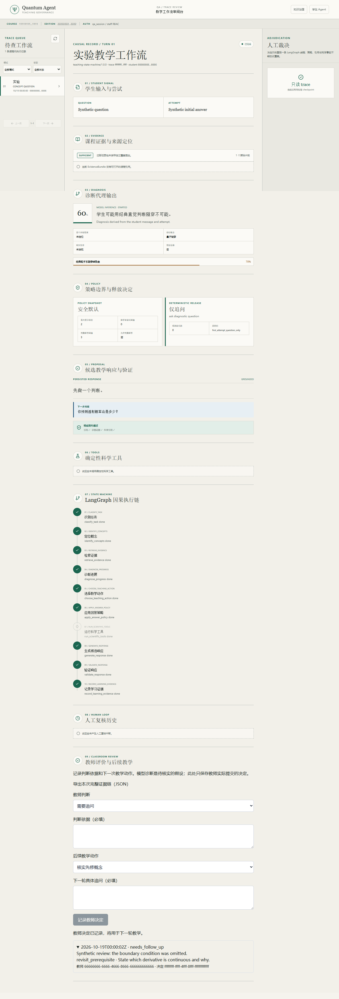

# 2026-10-19 课堂教学增量：审计、修复与验证

这是第一阶段的历史记录。后续 Linux / Docker / PostgreSQL、多 worker 浏览器验证、
统一预算和测评材料进展见 [2026-10-20 试用准备报告](CLASSROOM_TRIAL_READINESS.md)。
以下原始失败和当时尚未执行的事项保留，不代表后续工作没有完成。

本次在 `codex/classroom-teaching-evidence` 工作分支上改进现有 Python / LangGraph 权威后端和 React 界面，面向高等教育“AI + 教学”的科学正确性、可用性和证据要求。执行跨越 2026-10-19 至 20 日，没有发布网站、推送提交或组织真实课堂。本文中的测试输入、教师意见和截图均为明确标注的合成材料，不是实际教师批准或学生成绩。

基线为 `68fd4cd`；完整基线 SHA、工作区文件摘要见 [source-snapshot.json](evidence/classroom-20261019/source-snapshot.json)。这是一份未提交工作树的源码快照，不能冒充已部署镜像版本。部署版本须按 [LOCAL_STACK.md](LOCAL_STACK.md) 注入 `BUILD_REVISION`。早期 9 月验收仍是历史证据，不归属于本次代码。

## 审计顺序和已执行增量

先读 `AGENTS.md`、本地栈、权威后端、遗留 TypeScript 的边界和已有竞赛材料，再按风险开展修复；每个增量先做针对性回归，再运行集成检查。

| 优先级 / 问题 | 复现或风险 | 本次行为 |
|---|---|---|
| P0 科学近零验证 | 电子 `E=5 eV, V0=10 eV, a=2 nm` 的正透射约 `5.03e-20`，旧绝对容差允许错误的零值通过 | 独立边界匹配、生成代码核验和迁移评分均要求正值及相对精度；真实下溢仍为无法判定 |
| P0 身份与权限 | 任意有效模型 Key 都映射到同一个演示学生 | 个人课堂邀请标识身份，模型 Key 仅授权模型；未交换邀请不能作 bearer 会话；默认关闭共享演示登录，生产不接受该开关 |
| P0 证据与独立性 | 先修图边被直接作为学生缺失知识；错误任务/反馈后重试可能污染独立表现 | 图主题与有学生原句支持的候选困难分开；Solo 关联任务、保留首答，错配不评分，反馈后修订不记为独立首答通过 |
| P1 首轮与 HITL 恢复 | 无 conversation ID 的首轮重试重复建记录；HITL 落盘/检查点间崩溃、代理丢 ID 阻断恢复 | 可索引请求 ID 和输入摘要；相同输入回放，不同输入 409；决策 ID、操作者和输入相符才回放；包含注入崩溃测试 |
| P1 过期界面 | 延迟恢复、旧课程响应或旧失败重试重新填入当前界面 | 视图代数、课程/身份边界、取消恢复读和清理 mutation；重试沿用同一次请求 ID |
| P1 路由恢复 | 预算到期仍占半开探测租约，鉴权失败换路由，退避越过期限 | 释放取消/过期租约，凭证级鉴权冷却，单调用截止时间限制探测和重试 |
| P1 课堂登录突发 | 12 个独立合成邀请经同一代理，旧实现返回 10 次成功、2 次限流 | 验证后的邀请使用独立哈希配额；无效邀请仍有粗粒度限制；两端配额表均设 10,000 桶上限 |
| P2 复用与可维护性 | 教学目标、量规和教师评价未形成固定课程设计 | `finite-barriers@1.0.0` 固定目标 FB-O1–4、量规 FB-R1–4、阶段任务、适用条件和内容摘要；明确尚未实际教师审定 |
| P2 教师闭环 | 审阅记录未直接指导后续普通教学轮 | 教师/课程管理员填写理由、量规等级和具体追问；追加记录并用于后续符合条件的教学动作，保留所有学习门禁 |
| P2 完整证据与预算 | 原始事件列表截断且缺少统一导出、失败决策或版本关联 | 单过程完整 JSON 关联初答、干预、修订、工具、Solo 首答、教师决定、后续动作；逐行投影读取，超预算 413，无部分成功 |

另修复 Windows 导入 `resource` 导致 API 无法加载、课程路径跨平台校验、历史教师轨迹误用当前模式、旧迁移失败覆盖新成功的 Cognitive Mirror 等问题。Windows 上不执行缺少 POSIX 限制的本地不受信代码；要求命名空间隔离而不可用时明确拒绝。

## 新增课堂工作流

管理员在已激活课程中用 `issue-classroom-access` 发放个人短时邀请，随后学生用自己的模型凭据登录。教师权限来自数据库课程成员关系，不能由浏览器字段、提示词或模型 Key 获得。相同模型凭据不会合并学生记录。真实机构 SSO 尚待部署方接入。

有限势垒请求固定教学包引用；可通过 API 显式选择已知包版本，旧过程不能悄悄换包。自适应追问引用实际学生原句并询问依据/检验方法；模型分析仍是候选判断，不能自动认证掌握程度或先修缺失。

Solo 首次对应任务的作答在反馈和 HITL 之前追加保存，失败或拒绝也不丢失。错配/缺少任务 ID 的旧客户端请求不作为测评，须刷新客户端。活动 Solo 不返回参考结果、历史辅助或尚未应用的教师追问。后续正确修订与首次独立成功分开；应用内锁定无法证明现场没有外部帮助。

教师在 `/teacher/traces` 检查实际记录，填写判断依据并选择继续、要求修订或核实先修概念。后两者必须有具体问题。决定不会解锁 Solo、绕过承诺或替代学生作答。教师追问只在符合条件的普通教学轮应用，结果携带 review ID。TAs 可查看，不能写入本次教学评价决定。

学生只能读取自己的过程；本课程教学团队可监督课程记录。证据导出包含原始自由文本和身份 UUID，不自动匿名化。下载摘要用于检测文件变化，不是数字签名或教师身份认证。历史缺失版本保留未知，不补造旧模型/代码版本。
同一学生在同一课程的 Solo 锁覆盖其他版本、其他标签页和旧过程回放；返回响应前再次检查，防止先启动的帮助请求在锁定后抵达。当前 Solo 的安全恢复与测评仍可进行。保存的教学输出不证明浏览器已接收或学生已阅读。



上图是 Playwright 拦截 API 的界面测试。`Synthetic review` 是测试夹具，不能作为实际教师意见。重新截取需显式设置 `QA_CAPTURE_CLASSROOM_SCREENSHOT=1`；普通回归不覆盖文档截图。

## 自动化验证

最终结果见 [verification.json](evidence/classroom-20261019/verification.json)。Windows 主机使用锁定的 Python 3.12.14 依赖和 npm 锁文件；没有把本地结果当作 Linux 或真实基础设施验收。

| 检查 | 本地结果 |
|---|---|
| 便携 Python 回归 | 555 通过、1 跳过、30 排除，381.42 秒 |
| Node 单元、契约和旧栈 golden | 87 通过 |
| 合成 API 的真实浏览器契约 | 16 通过，21.2 秒 |
| `deepseek-flash` 核心真实模型合成契约 | 3 次结构化调用及 1 项不调用模型的保守处理通过；科学措辞仍有下述复核项 |
| Python Ruff / mypy；TypeScript | 通过，mypy 检查 155 个文件 |
| ESLint | 无错误，保留 3 个既有未使用变量警告 |
| 生产构建、Worker/托管清单、渲染 HTML、公开包秘密扫描 | 通过；扫描 31 个公开产物 |

- Python 全量便携检查的具体排除项保存在 [windows-test-exclusions.txt](evidence/classroom-20261019/windows-test-exclusions.txt)：28 项依赖 Linux 子进程限制、Windows 长路径/符号链接权限或 POSIX 文件模式，另排除 2 项显式 live 测试。不能据此声称 Linux 沙箱已验收。
- Ruff 检查 `quantum_agent tests alembic`，mypy 检查 `quantum_agent tests`；新基准与快照脚本另外检查。
- Node 单元/契约/旧栈 golden 测试、TypeScript、ESLint、Vinext 生产构建、Worker 导出与清单、渲染 HTML、客户端秘密扫描均单独执行。ESLint 的旧文件未使用变量警告在验证记录中保留。
- Playwright 使用真实 React 界面与合成 API，覆盖阶段门禁、过期响应、原请求重试、课程切换、教师理由/动作、Solo 任务关联和课程包/首答浏览器契约。新增 CI 浏览器任务；尚未在远程 CI 执行本次分支。
- 真实 Docker/PostgreSQL/Neo4j/Redis、Linux 沙箱隔离和课堂效果没有在本机验证。下述模型评价独立记录，不能代替带真实基础设施的多模态端到端验收。

便携后端复现（PowerShell，在 `services/api` 中）：

```powershell
$qaExclusions = Get-Content ../../docs/implementation/evidence/classroom-20261019/windows-test-exclusions.txt
$qaArguments = @('-q', '-m', 'not live_infra and not live_model', '--tb=short')
$qaArguments += $qaExclusions | ForEach-Object { "--deselect=$_" }
.\.venv\Scripts\python.exe -m pytest @qaArguments
```

Linux 应运行仓库完整后端与沙箱检查，不使用上述排除清单。前端常规命令为 `npm run test:unit`、`npx tsc --noEmit`、`npm run lint`、`npm run test:e2e`。在本 Windows 主机上直接运行了相同 ESLint 和 Vinext 可执行入口，绕过原有 Bash 环境封装；构建后检查 `dist/server/index.js` 的 ESM `default.fetch`、`dist/.openai/hosting.json`、`node --test tests/rendered-html.test.mjs` 和 `npm run check:secrets`。

### 可复现的真实模型合成评价

新增 [`evaluate-classroom-live.py`](../../scripts/evaluate-classroom-live.py) 调用生产模型路由、诊断和响应函数，读取仓库开发讲义的精确片段与摘要。讲义和图关系明确是未获教师审定的测试夹具，不经过数据库发布，也不冒充实际课程证据。`--offline` 不请求供应商；默认 live 最多 3 次请求，`--extended` 最多 8 次，全部文本候选强制为同一个 `deepseek-flash` 别名，禁止悄悄换模型。

已授权的 Windows 用户环境密钥可按以下方式使用，不输出其值（仓库根目录）：

```powershell
$env:USTC_API = [Environment]::GetEnvironmentVariable('USTC_API', 'User')
services/api/.venv/Scripts/python.exe scripts/evaluate-classroom-live.py --allow-live --extended
```

每次创建独立 `outputs/classroom-live-eval/<UUID>/report.json` 和不可补充的预算账本。每请求最多 2,048 个输出 token、64 KiB 请求正文；默认每能力 45 秒、总预算 480 秒，显式参数最多提高至每能力 120 秒、总预算 600 秒。报告保留合成答案、实际模型响应、HTTP 状态、延时、路由结果、供应商提供的用量、教学包与源码摘要；不记录密钥或原始异常正文。模型权重版本与货币成本仍为未知，不能从别名或 token 数补造。

慢响应条件下，核心 3 次请求可复现为：

```powershell
services/api/.venv/Scripts/python.exe scripts/evaluate-classroom-live.py --allow-live `
  --thinking-mode disabled --capability-seconds 120 --total-seconds 600
```

这是评价脚本的显式配置，不修改产品默认路由或教学请求预算。比较不同配置时须同时保存失败记录，不能只挑选通过的一次。

首次 45 秒配置的[失败记录](evidence/classroom-20261019/live-model-initial-failed.json)实际只发出 2 次请求，均未在期限内收到响应，其余依赖模型的用例被冷却期阻断或降级，不能写成“8 次模型判断错误”。无作答时的保守处理和 6 项确定性检查通过。该次源码清单单独保存在 [source-snapshot-initial-live.json](evidence/classroom-20261019/source-snapshot-initial-live.json)。初版报告中无响应请求的 `http_calls[].latency_ms` 延迟到整次结束才计算，首项因此虚高；应使用 `cases[].latency_ms`（45,000 / 45,015 ms）。后续脚本 schema/2 已分别记录响应头延时和截至取消/用例结束的耗时。

[两种 HTTP 客户端的最小请求](evidence/classroom-20261019/live-transport-controls.json)也均在 30 秒无响应。随后[关闭 thinking、上限 90 秒的独立最小请求](evidence/classroom-20261019/live-transport-thinking-disabled.json)以 HTTP 200 返回同名模型，耗时 74,547 ms，用量为 8 个输入、2 个输出 token。由于同时改变了时限和 thinking 配置，不能据此认定关闭 thinking 是成功原因。这些结果不是整个产品的端到端延时或模型准确率测量。

首轮[核心模型记录](evidence/classroom-20261019/live-model-core-before-precision.json)使用关闭 thinking、每能力 120 秒、总 600 秒的配置，3 次请求全部 HTTP 200、返回同名模型。正确作答未被标错，错误作答定位为模型候选推断，追问关联实际学生原句，均通过指定自动断言；无作答的保守处理不发请求。三项能力耗时 71.546、64.875、62.407 秒，供应商合计报告 5,432 个输入、1,370 个输出 token。连同此前保留的失败与诊断，到此共发起 8 次模型 POST；其中超时请求用量未知。此处约一分钟的单能力响应仍是课堂可用性限制，不能宣传为低延时。

原始输出也暴露自动断言的边界：正确作答的候选诊断把更长的衰减路程表述为 “longer decay length”。固定 κ 时衰减长度 `1/κ` 不变，增长的是势垒宽度/经过的衰减路程。开发代理已在[输出复核记录](evidence/classroom-20261019/live-evaluation-audit.json)中标记该措辞；这不是实际教师审定。释放给学生的是不含科学断言的原句追问，没有重复此措辞。通过有限契约不等于整段自然语言科学正确，教师仍需按规程检查候选诊断。

据此增加通用诊断指令，要求保持来源的物理术语和参数依赖关系，不把定义参数均固定的物理尺度描述为发生变化；没有加入势垒示例或按关键词改写输出。该预防性改进须继续接受真实教师复核，不能保证模型以后不再犯错。原始输出及其[对应源码清单](evidence/classroom-20261019/source-snapshot-core-before-precision.json)保留，不用后续结果覆盖。

修正后[再次执行核心评价](evidence/classroom-20261019/live-model-evaluation.json)，3 次实际请求和无作答保守处理均通过有限契约，正确作答的候选诊断明确以衰减距离为依据，没有重现上述措辞。三项能力耗时 61.703、91.547、68.610 秒，报告 5,493 个输入、1,315 个输出 token；这不是普遍准确性或低延时证明。整个增量累计发起 11 次模型 POST，7 次 HTTP 200 的已知用量合计 13,620 token，4 次超时请求用量和货币成本仍未知。生产默认路由未因此修改，其他模型、真实多模态与班级并发尚需单独验证。

## 性能与资源边界

相同有限势垒任务重复 15 次，初始绘图实现暖调用中位数 91.622 ms；有界不可变绘图缓存后的独立复测中位数及逐次样本见 [benchmark.json](evidence/classroom-20261019/benchmark.json)，约 0.25 ms。首调用仍约 0.55 秒。此结果仅说明重复科学绘图开销，不代表整体教学延时、并发性能或学习提升。

用 `services/api` 的环境从仓库根目录运行 `python scripts/benchmark-science.py` 可复测；Python 模块必须安装在该环境。缓存最多 16 项，超过 64 KB 的输入不缓存，返回新对象以防调用者污染。测试覆盖变异、驱逐和预算绕过。

导出上限为 500 轮、5,000 事件、500 教师决定和 8 MB；逐条序列化、超限关闭游标，避免加载全部重复快照。
第一阶段只有单次路由期限；后续 `0011` 已加入跨阶段、重试和恢复的统一单轮预算。
课堂部署仍需监控 provider 配额、调用次数、延时和失败率。
单轮版本元数据最多保存 128 条模型调用和 16 段暂停/恢复执行版本；达到上限不能把列表长度当作实际调用总量。

## 尚待实际执行与限制

1. 此项记录第一阶段尚未执行的 Linux、Docker、迁移、隔离攻击及多 worker 验证。
   后续实际执行状态以 [试用准备报告](CLASSROOM_TRIAL_READINESS.md) 为准；实际学校部署的负载、备份保管和恢复演练仍需部署方完成。
2. 用真实课程资料完成教师审阅/发布，并由真实任课教师审定教学包与量规。包内适用条件不能推广到任意势垒、不同渐近波数或整个量子课程。
3. 部署方核实镜像对应的完整代码 SHA，配置秘密保险库、TLS、机构身份、共享限流/监控和数据保管。当前限流表在单进程内有界，不是分布式全局配额。
4. 真实模型自动化合成评价仅覆盖小型固定样例，保留了超时与冷却结果；不能据此声称长期稳定、适合班级并发或已有准确率估计。供应商模型别名可能改变，超时请求的 token 用量和货币成本未知。
5. 真实教师和学生按 [课堂评价规程](CLASSROOM_EVALUATION_PROTOCOL.md)执行前测、干预、即时 Solo 和延迟独立测评。当前延迟测评和现场外部辅助监督由教师组织，没有自动监考或学习成效数据。
6. 历史请求丢失的元数据无法反推；旧客户端需刷新以携带任务/决策 ID。未提交的浏览器草稿不构成持久学习证据。导出不自动匿名化，追加保护也不等于完整的数据生命周期管理。

此次交付是可继续维护和真实试用的实现与验证材料，不是比赛认证、生产验收或教学有效性证明。
